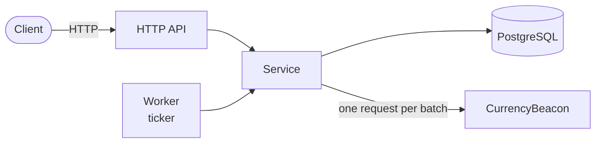
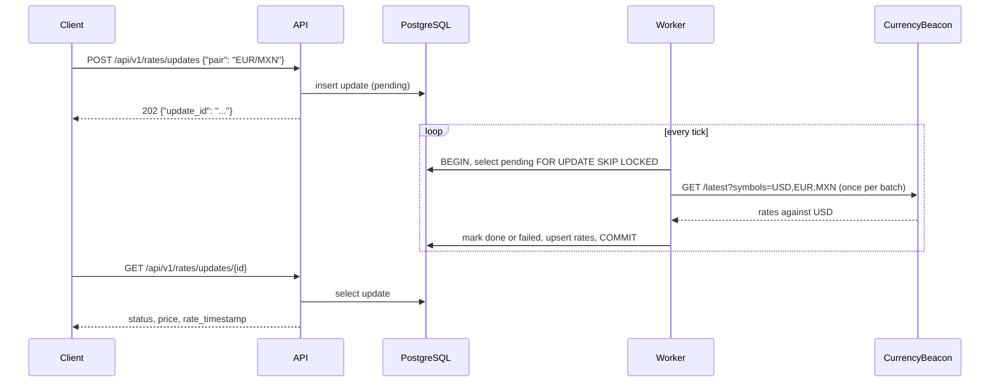

<p align="center">
  
</p>

<h1 align="center">Exchanger</h1>

Asynchronous currency rate service. A client requests a rate update for a pair, gets an id back immediately, and reads the result later. Rates are fetched in the background from [CurrencyBeacon](https://currencybeacon.com).

Supported currencies: USD, EUR, MXN.

## How it works





- The queue lives in PostgreSQL. The worker takes pending updates with `SELECT ... FOR UPDATE SKIP LOCKED`, so several instances can run side by side without processing the same update twice.
- All updates of a batch are resolved from a single provider response. The provider returns rates against USD, and any pair is derived as `quote / base`, rounded to 10 decimal places.
- If the provider call fails, the updates are retried with a growing delay (5 and 10 seconds) and become `failed` after 3 attempts. Rejected requests (4xx except 429) fail immediately.
- Prices are `NUMERIC(20,10)` in the database, `shopspring/decimal` in Go and strings in JSON, so no floats are involved.
- The latest rate per pair is kept in `rates` and is only overwritten by a snapshot that is not older.

## Quick start

Requirements: Go 1.25, Docker, [Task](https://taskfile.dev) and a free [CurrencyBeacon](https://currencybeacon.com) API key.

```bash
cp .env.example .env   # set CURRENCY_API_KEY
task up                # start PostgreSQL
task migrate:up        # apply migrations
```

Then start the service on `:8080`, locally or in Docker:

```bash
task run                    # locally
docker compose up --build   # or in Docker
```

## API

Swagger UI is available at <http://localhost:8080/swagger/index.html>. After changing the annotations, regenerate it with `task docs`.

A pair is written as `BASE/QUOTE`: the price is how many units of `QUOTE` one unit of `BASE` costs.

| Method | Path | Description |
| --- | --- | --- |
| POST | `/api/v1/rates/updates` | Request a rate update, returns `202` and `update_id` |
| GET | `/api/v1/rates/updates/{id}` | Status and result of an update |
| GET | `/api/v1/rates/latest?pair=EUR/MXN` | Last known rate of a pair |
| GET | `/health` | Liveness check |

```bash
curl -X POST localhost:8080/api/v1/rates/updates \
  -H 'Content-Type: application/json' -d '{"pair": "EUR/MXN"}'
# {"update_id":"01a18c89-ab67-733b-84ef-793e09d69989"}

curl localhost:8080/api/v1/rates/updates/01a18c89-ab67-733b-84ef-793e09d69989
# {"update_id":"01a18c89-ab67-733b-84ef-793e09d69989","pair":"EUR/MXN","status":"done","price":"21.1119191794","rate_timestamp":"2026-10-30T11:19:59Z","updated_at":"2026-10-30T11:19:59.251401Z"}

curl "localhost:8080/api/v1/rates/latest?pair=EUR/MXN"
# {"pair":"EUR/MXN","price":"21.1119191794","rate_timestamp":"2026-10-30T11:19:59Z","updated_at":"2026-10-30T11:19:59.251401Z"}
```

The worker polls every 5 seconds, so a fresh update is `pending` until the next tick.

Update status is `pending`, `done` or `failed`. Errors have the form `{"error": "..."}`: `400` for an invalid pair, id or body, `404` for an unknown update or a pair that has never been updated.

Pass an `Idempotency-Key` header to make retries safe: a repeated request with the same key returns the same `update_id`, and the same key with another pair returns `422`.

## Configuration

Defaults live in `config/app.toml`; environment variables override them. Secrets are read from the environment only.

| Variable | Description |
| --- | --- |
| `POSTGRES_DSN` | Required. PostgreSQL connection string |
| `CURRENCY_API_KEY` | Required. CurrencyBeacon API key |
| `HTTP_PORT` | HTTP port, `8080` by default |
| `LOG_LEVEL` | `debug`, `info`, `warn` or `error` |
| `WORKER_INTERVAL` | Polling interval, `5s` by default |
| `WORKER_BATCH_SIZE` | Max updates per tick, `100` by default |
| `CURRENCY_SUPPORTED` | Comma-separated currency codes |
